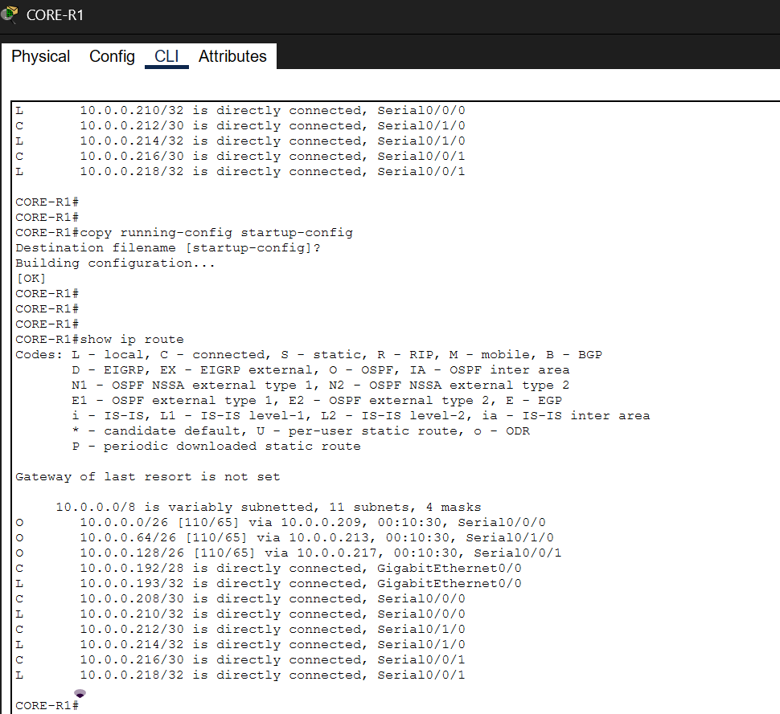
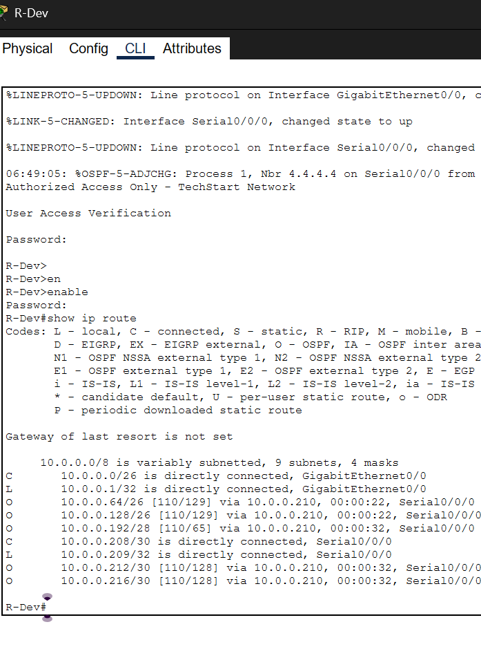
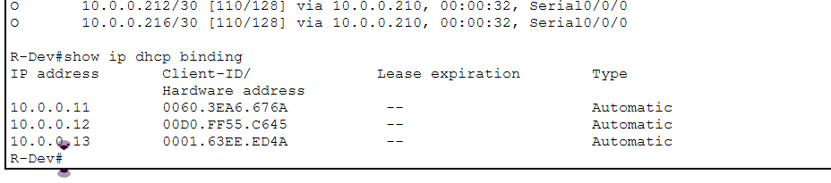
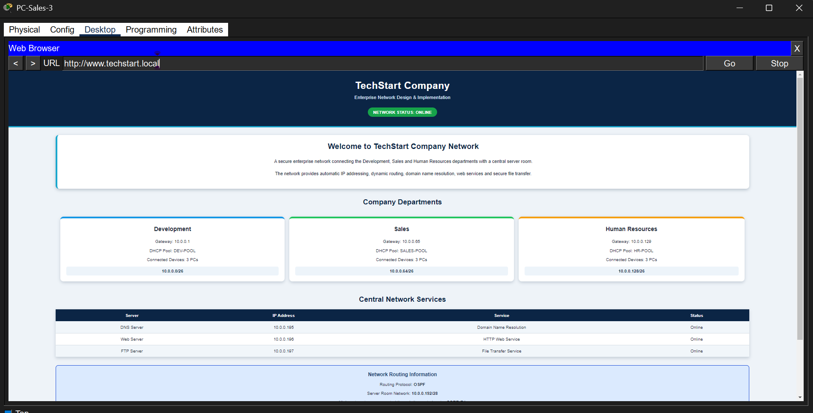
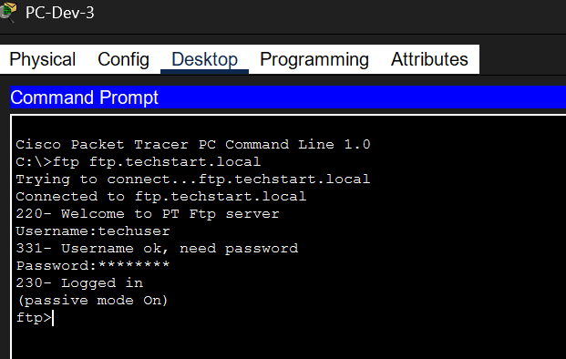
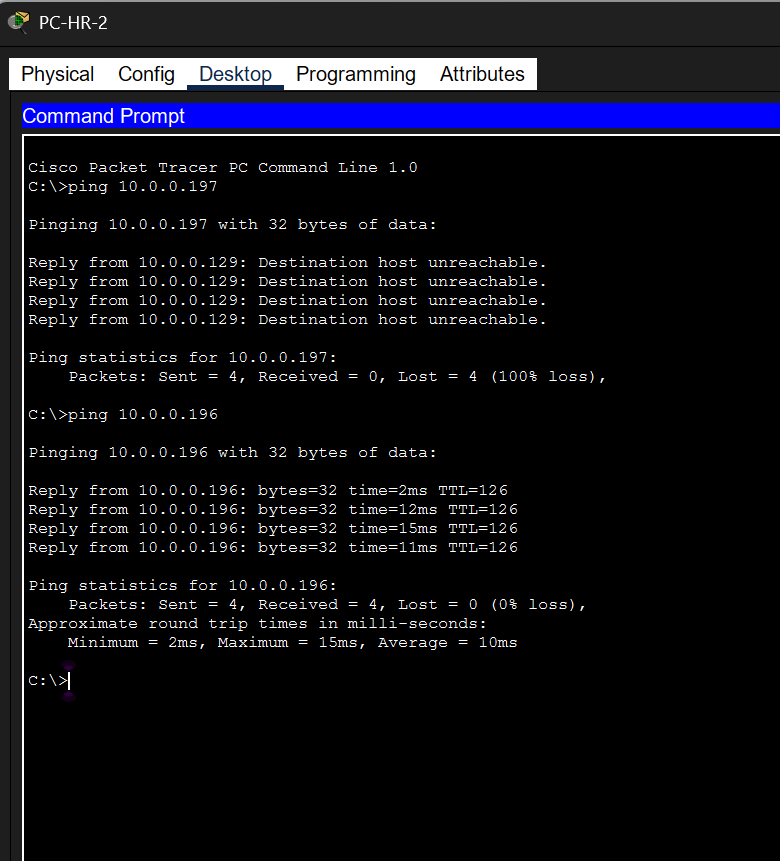
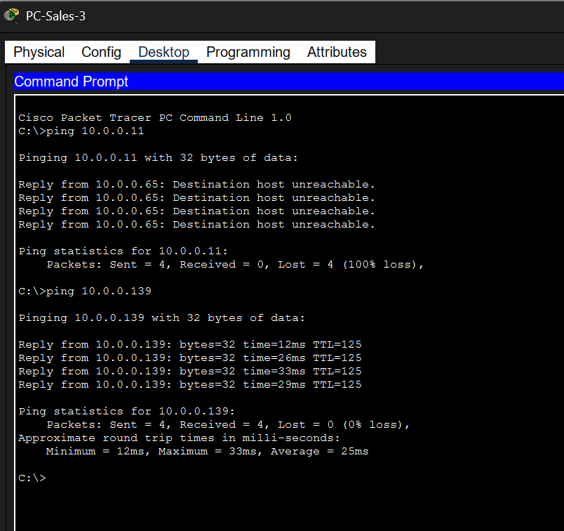

# TechStart Enterprise Network

A complete enterprise network design and implementation built using **Cisco Packet Tracer** for the **COMP 3115 – Practical Network Principles** course.

The project simulates a technology company network with three independent departments connected through a central core router and a dedicated server room.

## Project Overview

The TechStart network includes:

- Development Department
- Sales Department
- Human Resources Department
- Central Core Router
- Dedicated Server Room
- DNS Server
- Web Server
- FTP Server (lab-only; FTP is unencrypted)

Each department has its own LAN, router, switch, and client devices.

## Technologies & Networking Concepts

- Cisco Packet Tracer
- IPv4 Addressing
- VLSM / Subnetting
- DHCP
- Static IP Addressing
- OSPF Dynamic Routing
- DNS
- HTTP
- FTP
- SSH Version 2
- Extended Access Control Lists (ACLs)
- Network Connectivity Testing
- Network Verification and Troubleshooting

## Network Topology

The network uses a **hierarchical star topology**.

Each department router connects to the central **CORE-R1** router through a point-to-point `/30` WAN link.

The server room is connected directly to the core router and provides centralized network services.

## IP Addressing Plan

| Network | Network/CIDR | Usable Hosts |
|---|---|---:|
| Development LAN | `10.0.0.0/26` | 62 |
| Sales LAN | `10.0.0.64/26` | 62 |
| HR LAN | `10.0.0.128/26` | 62 |
| Server Room | `10.0.0.192/28` | 14 |
| Dev-Core WAN | `10.0.0.208/30` | 2 |
| Sales-Core WAN | `10.0.0.212/30` | 2 |
| HR-Core WAN | `10.0.0.216/30` | 2 |

VLSM was used to allocate the available IP address space efficiently.

## DHCP

DHCP is used for employee PCs, while routers, switches, and servers use static IP addresses.

Configured DHCP pools:

- `DEV-POOL`
- `SALES-POOL`
- `HR-POOL`

The DNS server address is automatically provided to DHCP clients.

## Network Services

### DNS

The DNS server provides internal name resolution for the TechStart network.

Configured records include:

- `www.techstart.local`
- `ftp.techstart.local`
- `dns.techstart.local`

### HTTP

A dedicated web server hosts a customized internal TechStart company webpage.

### FTP

A dedicated FTP server provides authenticated file transfer services in the Packet Tracer lab.

**Security note:** Traditional FTP transmits credentials and data without encryption. This service is for simulation only. For real networks, prefer **SFTP (SSH)** or an appropriately secured file-transfer service.

> Authentication credentials used in the lab environment are intentionally not included in this README.

## Routing

The network uses **OSPF Process 1 in Area 0** for dynamic routing.

OSPF exchanges routes between:

- Development
- Sales
- Human Resources
- Server Room
- CORE-R1

The routing tables verify that the departmental LANs and server network are reachable through OSPF.

## Security

The project includes several security features:

- SSH Version 2
- Local authentication
- Secure device administration
- MOTD security banner
- Extended ACLs

### ACL Rules

Two extended ACL scenarios were implemented:

1. **HR FTP Restriction**
   - Blocks the HR network from reaching the FTP server.
   - Other permitted traffic remains available.

2. **Sales to Development Restriction**
   - Blocks the Sales network from reaching the Development LAN.
   - Other permitted traffic remains available.

## Verification & Testing

The implementation was verified using routing tables, DHCP bindings, service tests, and ACL tests.

### CORE-R1 Routing Table

Shows the department networks learned through OSPF.



### R-Dev Routing Table

Shows routes from the Development router to the other networks.



### DHCP Address Allocation

Shows DHCP bindings assigned to Development PCs.



### Web Service Verification

The TechStart internal website is successfully opened through:

`http://www.techstart.local`



### FTP Service Verification

Successful FTP connection and authenticated login using the internal DNS name.



### HR ACL Restriction Test

The HR network is blocked from accessing the FTP server while permitted traffic remains available.



### Sales ACL Restriction Test

The Sales network is blocked from accessing the Development LAN while allowed communication remains available.



## Repository Structure

```text
TechStart-Enterprise-Network/
│
├── README.md
├── TechStart_Enterprise_Network.pkt
├── TechStart_Final_Report.pdf
│
└── screenshots/
    ├── core-r1-routing.png
    ├── r-dev-routing-table.png
    ├── dhcp-bindings.png
    ├── topology-web-page.png
    ├── ftp-login-test.png
    ├── hr-acl-block-test.png
    └── sales-acl-block-test.png
```

## How to Open the Project

1. Install **Cisco Packet Tracer**.
2. Download the `.pkt` file from this repository.
3. Open it using Cisco Packet Tracer.
4. Inspect the routers, switches, PCs, and servers.
5. Use the CLI and simulation tools to verify routing, DHCP, services, and ACL behavior.

## Project Result

The completed network demonstrates:

- Efficient subnetting using VLSM
- Dynamic client addressing with DHCP
- Dynamic routing using OSPF
- Centralized DNS, HTTP, and FTP services
- Secure remote device administration using SSH
- Traffic filtering using extended ACLs
- Successful network verification and testing

## Author

**Said Fouda**

Academic networking project developed using Cisco Packet Tracer.
